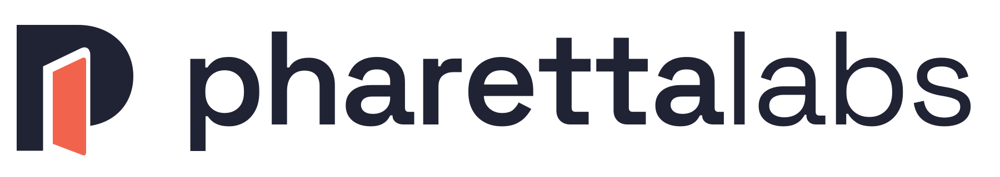

  <a href="https://pharettalabs.com">
    <picture>
      <source media="(prefers-color-scheme: dark)" srcset="pharettalabs-logo-light.png">
      
    </picture>
  </a>

# Hi, I'm John Strommen.

**I build useful software and help businesses find their next opportunity to grow.**

I'm the founder of [PharettaLabs](https://pharettalabs.com), an independent product and software studio rooted in Alpharetta, Georgia. I combine hands-on full-stack development with a background in product leadership, technical SEO, organic growth, and marketing.

I like taking a real problem, figuring out what matters, and turning it into something people can use. My three independently built products are examples of that approach.

## What I'm building

###  Second Summit

**A better next chapter for your career.**

A career platform that connects resume-to-job matching, tailored applications, professional branding, career guidance, and application tracking. Trailhead helps candidates fill out applications while keeping them in control of review and submission.

**The interesting challenge:** connecting multiple AI services to a coherent career journey and making application assistance useful across different employer systems.

[Explore Second Summit](https://secondsummit.ai) · [Read the build story](https://pharettalabs.com/work/second-summit/) · [GitHub showcase](https://github.com/johnstrommen-jstro306/second-summit-showcase)

###  BookWard

**Remember more of what you read. Discover what comes next.**

A personalized reading app with editable AI Book Companions, recommendations, reading goals, library imports, and cover and barcode scanning. It began as my own solution for remembering useful ideas from books.

**The interesting challenge:** combining book catalogs, resolving inconsistent editions and duplicates, and turning personal reading preferences into useful discovery.

[Explore BookWard](https://bookward.ai) · [Read the build story](https://pharettalabs.com/work/bookward/) · [GitHub showcase](https://github.com/johnstrommen-jstro306/bookward-showcase) · [Monthly book rankings](https://bookward.ai/top-100-books/)

###  Punch List

**Less household juggling. More getting things done.**

A household task app that turns photos and forwarded emails into tasks, with shared and private lists, assignments, reminders, planning, and Google Calendar and Tasks integrations. It started with a grocery list and Siri Shortcuts.

**The interesting challenge:** bringing AI, email, calendars, and household sharing together while keeping everyday use simple.

[Explore Punch List](https://mypunchlist.ai) · [Read the build story](https://pharettalabs.com/work/punch-list/) · [GitHub showcase](https://github.com/johnstrommen-jstro306/punch-list-showcase)

## Experience behind the builds

My background spans enterprise platforms, consumer products, e-commerce, and local service businesses. Selected experience includes:

- **Compass:** staff product management across SEO, growth, and AI-powered discovery, including product roadmaps and organic performance measurement.
- **Redfin:** principal product management for organic growth, including the technical and SEO integration of Rentals.com into Redfin.com across more than 100 million pages.
- **RentGroup / RentPath:** SEO leadership, scalable content and internal linking systems, technical search improvements, and app store optimization that doubled app downloads.
- **Alloy Roofing:** VP of Marketing, combining growth strategy with hands-on CRM, call-center, lead-nurturing, and AI workflow implementation across acquired businesses.
- **CouponCabin and Walgreens:** technical SEO, search recovery, content systems, and e-commerce growth. At Walgreens, increased non-brand SEO revenue by 347%.

I hold a B.S. in Web & Digital Media Development and Business Administration from the University of Wisconsin–Stevens Point.

## Tools and areas I work in

| Area | Tools and focus |
| --- | --- |
| Applications | JavaScript, HTML, CSS, SQL, responsive web apps and mobile experiences |
| Backend and delivery | Supabase, Netlify, Resend, API integrations, email workflows |
| AI products | OpenAI, Anthropic, Google AI; conversational features, matching, recommendations, and document processing |
| Product | Discovery, roadmaps, prioritization, UX, experimentation, and ongoing iteration |
| Growth | Technical SEO, structured data, indexation, content strategy, AI discovery, analytics, and conversion optimization |

I use Codex and Claude Code in my development workflow, with hands-on product direction, review, and testing.

## A small tool you can use

[SEO Page Check](https://github.com/johnstrommen-jstro306/seo-page-check) is a dependency-free Python utility for inspecting saved HTML: metadata, canonicals, robots directives, image alt attributes, and JSON-LD syntax. It runs locally, includes tests, and is available under the MIT license.

## Work with me

Through PharettaLabs, I help businesses build custom apps, connect existing systems, add useful AI features, improve older products, and develop practical product and growth strategies. I also support ongoing development and maintenance.

You work directly with me, from the first question through launch and iteration.

**Have a problem worth solving?** [Visit PharettaLabs](https://pharettalabs.com) or [try the Idea Lab](https://pharettalabs.com/start/).

[LinkedIn](https://www.linkedin.com/in/johnstrommen/) · [Email](mailto:john@pharettalabs.com)
